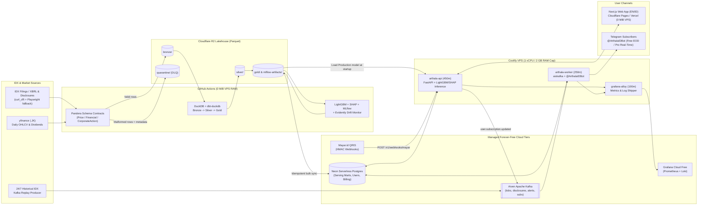

# Arthala ID — *by Robit Al Hazmi*

[](https://github.com/robitalhazmi/arthala-id/actions/workflows/ci.yml)


> **Open-Source, Zero-Cost-Cloud IDX Fundamental, Dividend & MLOps Intelligence Platform**  
> **Brand:** **Arthala ID** — *by Robit Al Hazmi* (`arthala-id` / Telegram: `@ArthalaIDBot`)

---

## 1. Executive Summary

**Arthala ID by Robit Al Hazmi** is a cloud-native Indonesian Stock Exchange (**IDX / BEI**) fundamental, dividend, and real-time risk intelligence platform built around three goals:

1. **Personal IDX Investing Workflow:** Automated quarterly financial statement ingestion, annualized valuation ratios, dividend sustainability tracking, and real-time red-flag / accounting anomaly alerts.
2. **Bank OCBC NISP Data Engineer Portfolio:** Production-grade Medallion Lakehouse (**Cloudflare R2 + DuckDB + dbt-duckdb**), strict **Pandera** schema contracts with an R2 Quarantine/DLQ, real-time **Apache Kafka** streaming (**Aiven + `aiokafka`**), and versioned/monitored MLOps (**LightGBM + bilingual SHAP + MLflow + Evidently AI**) engineered within a strict **1 vCPU / 2 GB Coolify VPS** budget.
3. **Indonesia-First Public Monetization:** A bilingual (`EN | ID`) **Freemium Next.js Web Dashboard** paired with a **Paid Real-Time Telegram Alert Bot (`@ArthalaIDBot`, Rp39.000/month via Mayar.id QRIS)**.

---

## 2. System Architecture



---

## 3. Bank OCBC NISP Job-Requirement Traceability Matrix

| Bank OCBC NISP Job Requirement | Arthala ID Implementation | Repository Location |
|---|---|---|
| **Scalable, low-latency ETL/ELT pipelines (Kafka, Spark/Airflow/Flink equivalents)** | Medallion Lakehouse (R2 Bronze/Silver/Gold via DuckDB + dbt-duckdb) orchestrated via GitHub Actions + portable Airflow DAGs; real-time Kafka streaming via Aiven + `aiokafka` + 24/7 Historical Market Replay Producer. | [`/pipelines/ingestion`](pipelines/ingestion), [`/pipelines/dbt`](pipelines/dbt), [`/pipelines/replay`](pipelines/replay), [`/pipelines/airflow`](pipelines/airflow) |
| **Integrate ML models into production via APIs, microservices & containers** | Versioned LightGBM + SHAP models loaded from MLflow/R2 into containerized FastAPI inference microservice (`POST /v1/predict/distress`, `GET /v1/tickers/{symbol}/score`). | [`/apps/api`](apps/api), [`/infra/docker`](infra/docker) |
| **Real-time & batch inference for credit scoring, fraud detection & personalization** | **v1:** Financial Distress & Accounting Anomaly Score (Accruals Ratio, Altman Z-Score, Beneish M-Score, Short-Term Debt Pressure). **v1.5:** Dividend Sustainability + Kafka streaming anomaly detection. **v2:** Personalized portfolio risk screener. | [`/pipelines/ml`](pipelines/ml), [`/apps/worker`](apps/worker) |
| **Convert DS prototypes into monitored production services with versioning & auto-retraining** | MLflow Model Registry (`Staging` -> `Production` promotion gate), scheduled weekly GitHub Actions retraining, Evidently AI drift detection triggering automated retrain jobs. | [`/pipelines/ml`](pipelines/ml), [`.github/workflows/`](.github/workflows) |
| **Architect big data infrastructure on cloud/hybrid (Cloud, Lakehouse, IaC, Docker, K8s)** | Cloud-native hybrid architecture (Cloudflare R2 + Neon + Aiven Kafka + Coolify VPS) with production Dockerfiles, Terraform IaC for cloud resources, and Helm/k3s manifests. | [`/infra/terraform`](infra/terraform), [`/infra/k8s`](infra/k8s), [`/infra/coolify`](infra/coolify) |
| **Optimize query performance, resource allocation & storage at scale** | Hive-partitioned Parquet (`dt=YYYY-MM-DD`, `fiscal_year=YYYY`), DuckDB predicate pushdown, Postgres covering indexes, and strict container memory budgets. | [`/pipelines/dbt`](pipelines/dbt), [`/infra/sql/ddl.sql`](infra/sql/ddl.sql) |
| **Embed data-quality checks, observability & MLOps practices** | Pandera schema contracts with R2 Quarantine/DLQ routing, dbt generic/singular tests, Prometheus metrics (`/metrics`), structured JSON logs (`structlog`), Grafana Cloud dashboards, and `/status` page. | [`/pipelines/ingestion/contracts.py`](pipelines/ingestion/contracts.py), [`/apps/api`](apps/api) |
| **Fluent Python, SQL, RESTful design, CI/CD, GitHub best practices** | Python 3.12 (`uv`), strict `ruff` + `mypy` + `pytest`, SQL/dbt, OpenAPI v3 REST design, trunk-based PR workflow, GitHub Actions CI/CD, Dependabot, and `gitleaks` scanning. | [`.github/workflows/ci.yml`](.github/workflows/ci.yml), [`pyproject.toml`](pyproject.toml) |

---

## 4. Tech Stack & 2 GB Coolify VPS Resource Budget

### Zero-Cost Market-Leader Stack

| Layer | Technology | Hosting / Tier |
|---|---|---|
| **Frontend Web App** | Next.js (App Router, TypeScript, Tailwind CSS, TradingView Lightweight Charts, `EN \| ID`) | **Cloudflare Pages / Vercel** (Free Tier — `0 MiB` on VPS) |
| **Backend API & ML Serving** | Python 3.12 (`uv`), FastAPI, Uvicorn (`--workers 1`), Pydantic v2, LightGBM, SHAP | **Coolify VPS** (`arthala-api`, `mem_limit: 450m`) |
| **Streaming & Alert Worker** | Aiven for Apache Kafka + Python `aiokafka` + `python-telegram-bot` (`@ArthalaIDBot`) | **Aiven Free** + **Coolify VPS** (`arthala-worker`, `mem_limit: 250m`) |
| **Lakehouse Storage** | Cloudflare R2 (S3-compatible Parquet: `bronze/`, `silver/`, `gold/`, `quarantine/`, `mlflow-artifacts/`) | **Cloudflare R2** (10 GB Free, zero egress) |
| **Batch Compute & Transform** | DuckDB + `dbt-duckdb` + Pandera data quality contracts | **GitHub Actions** (Scheduled Cron Runners) |
| **Serving Database (OLTP)** | Neon Serverless Postgres (marts, watchlists, auth, Mayar billing, pipeline watermarks) | **Neon Free** |
| **MLOps & Drift Monitoring** | MLflow Registry + Evidently AI | **GitHub Actions** + R2/Neon |
| **Payments (QRIS)** | Mayar.id Payment Links + HMAC-verified idempotent webhooks | **Mayar.id** |
| **Observability** | Prometheus (`/metrics`), `structlog` JSON, Grafana Alloy -> Grafana Cloud | **Grafana Cloud Free** + **Coolify VPS** (`grafana-alloy`, `mem_limit: 100m`) |

### Strict 1 vCPU / 2 GB Coolify VPS Memory Budget

| Component | Host | Docker `mem_limit` | Expected RAM | Notes |
|---|---|---|---|---|
| Host OS + Docker + Coolify + Traefik | Coolify VPS | Host-managed | ~500 MiB | Baseline Coolify footprint (+ 2 GB swap enabled) |
| `arthala-api` (FastAPI + LightGBM/SHAP) | Coolify VPS | **`450m`** | ~300–350 MiB | `--workers 1`; ML artifacts loaded once at startup |
| `arthala-worker` (`aiokafka` + `@ArthalaIDBot`) | Coolify VPS | **`250m`** | ~180–200 MiB | Async consumer + Telegram alert dispatcher |
| `grafana-alloy` (Metrics & Log Shipper) | Coolify VPS | **`100m`** | ~70–80 MiB | Ships to Grafana Cloud Free |
| **Rolling Deploy & Spike Headroom** | **Coolify VPS** | — | **~900 MiB free** | Zero JVM/Spark/Airflow/Kafka brokers on VPS |

---

## 5. Tiered Feature & Monetization Model

| Feature | Free Tier (Public Web + Basic Bot) | Pro Tier (Rp39.000/mo via Mayar.id QRIS) |
|---|---|---|
| Public IDX Screener (PER, PBV, ROE, DER, Yield) | Full access (EOD delayed) | Full access + advanced filters |
| Ticker Deep-Dive (Lightweight Charts + Fundamentals) | Full access | Full access + 5-year quarterly history |
| v1 ML Financial Distress & Anomaly Score | Traffic-light badge (`SAFE` / `WATCH` / `HIGH_RISK`) | Exact probability score + Top-3 SHAP reasons (`EN` / `ID`) |
| Personal Watchlist & Dividend Cum-Date Calendar | Up to 5 tickers | Unlimited tickers |
| Telegram Alerts (`@ArthalaIDBot`) | Daily EOD summary only | Instant real-time Kafka-driven alerts |

---

## 6. Monorepo Structure

```text
arthala-id/
├── .agents/workflows/          # Antigravity slash workflows (/next-task, /verify-all, /run-etl-local, /pr-ready)
├── .github/                    # CI/CD workflows, CODEOWNERS, PR/Issue templates, Dependabot
├── apps/
│   ├── api/                    # FastAPI REST API, LightGBM+SHAP online inference, Mayar QRIS webhooks, /metrics
│   ├── worker/                 # Async Kafka consumer, anomaly/disclosure rule engine, @ArthalaIDBot
│   └── web/                    # Next.js (App Router, TypeScript, Tailwind, Lightweight Charts, EN/ID)
├── pipelines/
│   ├── ingestion/              # Multi-source IDX/yfinance scrapers, Pandera contracts, R2 Quarantine/DLQ, Neon sync
│   ├── dbt/                    # dbt-duckdb Bronze -> Silver -> Gold marts & ML feature stores
│   ├── ml/                     # LightGBM training, MLflow registry, bilingual SHAP explainability, Evidently drift
│   ├── replay/                 # 24/7 Historical IDX tick & disclosure Kafka Replay Producer
│   └── airflow/                # Portable Airflow DAG mirrors (OCBC orchestration showcase)
├── infra/
│   ├── docker/                 # docker-compose.local.yml (offline Postgres 16, MinIO, Redpanda)
│   ├── coolify/                # docker-compose.prod.yml (strict VPS memory caps)
│   ├── k8s/                    # k3s / Helm manifests (OCBC Kubernetes showcase)
│   ├── terraform/              # IaC definitions for Cloudflare R2, Neon, Aiven
│   └── sql/ddl.sql             # Idempotent Neon Postgres serving schema
├── docs/                       # Implementation_Plan.md, Task.md, Walkthrough.md
├── pyproject.toml              # Python 3.12 uv workspace, ruff, mypy (strict), pytest
└── Justfile                    # Standardized local dev, sandbox & quality gate commands
```

---

## 7. Local Development Quickstart

### Prerequisites
- Python **3.12+** & [`uv`](https://docs.astral.sh/uv/)
- Docker & Docker Compose v2
- [`just`](https://github.com/casey/just) command runner (`uv tool install rust-just`)
- Node.js **22 LTS** (for `apps/web`)

### Bootstrap & Run Offline Sandbox

```bash
# 1. Install locked Python dependencies, pre-commit hooks, and local .env
just bootstrap

# 2. Boot local Postgres 16 (port 5432), MinIO (9000/9001), and Redpanda (9092/8080)
#    Automatically applies infra/sql/ddl.sql, creates bucket `arthala-lakehouse`,
#    and initializes Kafka topics (`idx.ticks.raw`, `idx.disclosures.raw`,
#    `alerts.dispatch`, `user.subscription.updated`).
just up

# 3. Run all CI quality gates (ruff check, ruff format --check, mypy --strict, pytest --cov, compose-check)
just check

# 4. Stop local sandbox containers
just down
```

---

## 8. Canonical Documentation

- [`AGENTS.md`](AGENTS.md) — Engineering standards, 2 GB VPS guardrails, and Antigravity IDE agent workflow.
- [`docs/Implementation_Plan.md`](docs/Implementation_Plan.md) — System architecture, R2 Medallion layout, Neon DDL, and ML formulations.
- [`docs/Task.md`](docs/Task.md) — Master phased engineering checklist.
- [`docs/Walkthrough.md`](docs/Walkthrough.md) — Local sandbox setup, zero-cost cloud provisioning, Coolify deploy, and 3-minute OCBC interview demo script.

---

## License

MIT © **Robit Al Hazmi**
